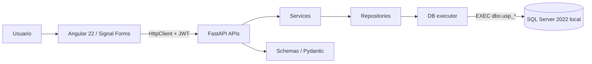

# TecnoStock S.A.C. — Sistema web de inventario

Aplicación web para administrar productos, categorías, entradas, salidas, existencias, stock bajo e historial de inventario. El proyecto conserva la identidad visual del frontend original y lo conecta con la API real de FastAPI y SQL Server.

## Stack

- **Frontend:** Angular 22.2.4, standalone components, Signals y Signal Forms; Bootstrap 5.3.8 (CSS solamente) y Bootstrap Icons 1.13.2; SCSS/CSS propio mobile-first.
- **Backend:** Python 3.12, FastAPI, Uvicorn, Pydantic v2, pydantic-settings, pyodbc, PyJWT y Argon2 mediante pwdlib.
- **Base de datos:** SQL Server 2022 Express instalado localmente en Windows (instancia `SQLEXPRESS`).
- **Conectividad:** Microsoft ODBC Driver 18 for SQL Server; TCP/IP local en `localhost:1433`.
- **Persistencia:** exclusivamente procedimientos almacenados `dbo.usp_*`; el código Python no contiene SQL de negocio.
- **Pruebas:** pytest, httpx y TestClient.

## Instalación de SQL Server 2022 local

Antes de ejecutar TecnoStock, instala y configura SQL Server 2022 Express en Windows. Sigue la guía detallada en [`docs/INSTALACION_SQL_SERVER_LOCAL.md`](docs/INSTALACION_SQL_SERVER_LOCAL.md). Si vas a trasladar el proyecto a otro equipo, sigue [`docs/INSTALACION_EN_OTRA_PC.md`](docs/INSTALACION_EN_OTRA_PC.md), que también explica cómo migrar el backup de la base de datos. En resumen:

1. Instala SQL Server 2022 Express como motor de base de datos, con nombre de instancia `SQLEXPRESS`.
2. Selecciona autenticación de modo mixto y define una contraseña segura para `sa`. Añade tu cuenta de Windows como administrador de SQL Server.
3. Habilita TCP/IP para la instancia y configura el puerto fijo `1433` en `IPAll`; reinicia el servicio `SQL Server (SQLEXPRESS)`.
4. Instala Microsoft ODBC Driver 18 for SQL Server (64 bits) y SQL Server Management Studio (SSMS) para administrar la base de datos.
5. Comprueba que puedas conectar desde SSMS al servidor `localhost,1433` con autenticación de SQL Server y el login `sa`.

No se requiere virtualización ni un servicio de contenedores: el motor de base de datos es un servicio instalado directamente en Windows.

## Inicio rápido en Windows 11

Después de completar la instalación local de SQL Server y los prerrequisitos:

1. Instala Python 3.12 de 64 bits, Node.js compatible con Angular 22.2.4 y Microsoft ODBC Driver 18 for SQL Server (64 bits).
2. Abre PowerShell en la raíz de `TecnoStock` (o la carpeta donde descomprimiste el ZIP).
3. Permite scripts para la sesión actual y ejecuta:

```powershell
Set-ExecutionPolicy -Scope Process -ExecutionPolicy Bypass
.\setup.ps1
```

`setup.ps1` solicita la contraseña que configuraste para el login `sa` durante la instalación local de SQL Server. La guarda en ambos archivos `.env` sin mostrarla. También genera las credenciales de la cuenta restringida de la API, el secreto JWT y la contraseña del administrador demo. Guarda la contraseña del usuario demo `admin` que muestra el script.

Después ejecuta:

```powershell
.\run.ps1
```

`run.ps1` comprueba el servicio de Windows `MSSQL$SQLEXPRESS`, la conexión TCP local y el controlador ODBC; prepara el entorno Python, instala dependencias, compila Angular, ejecuta pruebas, inicializa la base, carga datos demo y abre FastAPI y Angular en ventanas separadas.

Direcciones locales:

- Frontend: <http://localhost:4200>
- Swagger: <http://localhost:8000/docs>
- API: <http://localhost:8000/api/v1>
- Salud: <http://localhost:8000/health>

Para detener Angular y FastAPI, cierra sus ventanas de PowerShell. SQL Server permanece funcionando como servicio de Windows. Para detenerlo, abre SQL Server Configuration Manager o `services.msc` y detén **SQL Server (SQLEXPRESS)**. No elimines la carpeta de datos de la instancia.

## Requisitos y versiones

- Windows 10/11 y PowerShell 5.1 o PowerShell 7.
- SQL Server 2022 Express, instancia `SQLEXPRESS`, autenticación de modo mixto y TCP/IP escuchando en el puerto `1433`.
- SQL Server Management Studio (SSMS), recomendado para administrar y verificar la base.
- Python 3.12 (el script comprueba `py -3.12`).
- Node.js 22.22.3 o superior dentro de 22.x, 24.15.0 o superior dentro de 24.x, o 26.x, según la tabla oficial de compatibilidad de Angular 22.
- npm compatible con la versión de Node instalada.
- Microsoft ODBC Driver 18 for SQL Server, 64 bits, instalado en Windows.

> La guía del curso indica Node >= 22.12, pero el lockfile recibido resuelve Angular 22.2.4, cuyas dependencias declaran un mínimo más reciente. Se sigue el requisito efectivo de los paquetes instalados para evitar fallos de instalación.

## Arranque manual

Si prefieres ejecutar cada paso por separado:

```powershell
Set-ExecutionPolicy -Scope Process -ExecutionPolicy Bypass
.\setup.ps1
# Guarda la contraseña de admin que muestra setup.ps1; conserva ambos .env locales.

py -3.12 -m venv backend/.venv
.\backend\.venv\Scripts\Activate.ps1
python -m pip install -r backend/requirements-dev.txt

# SQL Server (SQLEXPRESS) debe estar iniciado y escuchando en localhost:1433.
.\backend\.venv\Scripts\python.exe .\backend\scripts\init_db.py
.\backend\.venv\Scripts\python.exe .\backend\scripts\seed.py
.\backend\.venv\Scripts\python.exe -m pytest backend/tests -q

Set-Location frontend
npm ci
npm run build
npm test -- --watch=false
npm start
```

En otra terminal, desde la raíz:

```powershell
Set-Location backend
.\.venv\Scripts\Activate.ps1
uvicorn app.main:app --reload --port 8000
```

En desarrollo Angular usa un proxy definido en `frontend/proxy.conf.json`: `/api` y `/health` se redirigen a `http://localhost:8000`. La aplicación no necesita conocer credenciales de base de datos ni secretos de JWT.

## Funcionalidades conectadas

- **Login:** `POST /auth/login`, `GET /auth/me`, token Bearer en `sessionStorage`, guard de acceso y guard de invitado.
- **Dashboard:** indicadores de productos activos, stock bajo, valor referencial, entradas/salidas del rango, últimos movimientos y productos críticos.
- **Categorías:** listar, crear, editar y eliminar; el servidor impide borrar categorías asociadas a productos.
- **Productos:** listar, búsqueda por código/nombre, filtros por categoría y estado, paginación, alta, edición, activación/desactivación y eliminación condicionada.
- **Movimientos:** búsqueda de productos activos, entrada y salida; el formulario muestra stock actual/mínimo y la respuesta muestra el stock anterior y posterior.
- **Historial:** filtros por producto, fechas y tipo; paginación y usuario que registró el movimiento.
- **Stock bajo:** listado desde el procedimiento almacenado con acceso directo a registrar una entrada.

Los formularios se implementan con Angular Signal Forms (`form`, `FormField`, validadores y `submit`). Los errores HTTP y de validación de Pydantic se muestran en los formularios; los listados vuelven a consultar la API después de mutaciones. El sidebar es fijo en escritorio y off-canvas en móvil. No hay datos de negocio de demostración en el frontend.

## Arquitectura



Responsabilidades: APIs resuelve HTTP y dependencias; Schemas define contratos y valida datos; Services aplica reglas y orquesta; Repositories invoca SP; `db/executor.py` es el único ejecutor de procedimientos. Los routers son funciones síncronas `def` porque pyodbc es síncrono.

## Inicialización de SQL Server

Después de instalar SQL Server local y preparar los `.env`, inicializa la base y los datos demo con:

```powershell
.\database.ps1 -Action all
```

El script usa expresamente `backend/.venv/Scripts/python.exe`; no uses `py -3.12 backend/scripts/init_db.py`, porque `py` selecciona el intérprete global y no el entorno virtual activado. Para ejecutar los pasos por separado, usa el ejecutable de `.venv` mostrado en el ejemplo de arranque manual.

`database/01_create_database.sql` a `database/10_seed_data.sql` se ejecutan en orden mediante `backend/scripts/init_db.py`, que separa lotes `GO`. El usuario administrativo `sa` solo se utiliza para crear la base y el usuario de aplicación; FastAPI se conecta exclusivamente como `tecnostock_app`, con permiso `EXECUTE` sobre el esquema y sin permisos directos a tablas.

El seed crea un usuario `admin`, cinco categorías y quince productos. Las existencias iniciales se crean mediante SP de entrada, para que el historial y el stock permanezcan consistentes.

## Pruebas

Las pruebas backend y frontend se ejecutan automáticamente desde `run.ps1`. También puedes ejecutarlas manualmente:

```powershell
.\backend\.venv\Scripts\python.exe -m pytest backend/tests -q

Set-Location frontend
npm ci
npm test -- --watch=false
```

La suite automatizada comprueba contratos de tablas/SP, validaciones, errores de pyodbc, servicios, API y seguridad. También verifica que no existan `SELECT/INSERT/UPDATE/DELETE` inline en `backend/app`.

Para verificar la integración con SQL Server, ejecuta `init_db.py` y `seed.py`, inicia FastAPI y prueba el recorrido de `database/PRUEBAS_MANUALES.md`. La suite de mocks no sustituye la ejecución contra un SQL Server real.

## Incidencias Windows

Consulta `docs/ERRORES_WINDOWS.md` para los errores de Angular Signal Forms, el uso del intérprete correcto para `pyodbc`, los problemas de conexión TCP, autenticación SQL Server y los archivos `.env`.

## Seguridad y variables de entorno

- `.env` y `backend/.env` son secretos locales ignorados por Git. Solo se versionan los `.env.example`.
- `MSSQL_SA_PASSWORD` es la contraseña administrativa configurada durante la instalación local; se usa solo para inicializar la base y crear el login restringido de la API.
- `tecnostock_app` es la cuenta que utiliza FastAPI. Nunca se conecta como `sa`.
- No se almacena ningún secreto en Angular. `environment.ts` contiene únicamente la ruta `/api/v1`.
- JWT Bearer en todos los endpoints protegidos. Las contraseñas de usuarios se almacenan con Argon2.
- CORS limitado a `http://localhost:4200` en la configuración de desarrollo.
- Token de frontend guardado en `sessionStorage`: al cerrar la pestaña/sesión se pierde; ante un XSS, JavaScript malicioso podría leerlo. Para el alcance académico no se agrega refresh token ni cookie HttpOnly.
- Los errores 500 no exponen trazas al cliente; el detalle queda en el log.

## Git y GitHub

El ZIP de distribución no incluye la carpeta `.git` ni un archivo `.bundle`; contiene el código fuente, no un historial de commits recuperable. Consulta [`docs/GIT_Y_GITHUB.md`](docs/GIT_Y_GITHUB.md) para inicializar un repositorio desde el estado actual y trabajar con ramas y Pull Requests reales.

Para crear y publicar un repositorio desde la carpeta extraída, configura primero tu identidad Git y ejecuta:

```powershell
git config --global user.name "Tu nombre"
git config --global user.email "tu-correo-de-GitHub"
winget install --id GitHub.cli -e
# Cierra y vuelve a abrir PowerShell después de instalar GitHub CLI.
.\publish-github.ps1
```

Si el proyecto todavía no tiene `.git`, el script crea un único commit de importación del estado actual, crea el repositorio remoto y publica `main`. No inventa fechas, commits ni Pull Requests. Las ramas y PRs adicionales deben corresponder a cambios reales realizados después de esa importación.

## Estructura

```text
TecnoStock/
├── database/                 # tablas, índices, SP, permisos y pruebas manuales
├── backend/app/              # APIs, schemas, services, repositories, db y core
├── backend/scripts/          # init_db.py y seed.py
├── backend/tests/            # pruebas API, servicio y contratos
├── frontend/src/app/core/    # modelos, servicios, guards e interceptors
├── frontend/src/app/features/ # login, dashboard, categorías, productos y movimientos
├── frontend/src/app/shared/  # mensajes de error de Signal Forms
├── docs/                     # arquitectura, datos, API, instalación y sustentación
│   ├── INSTALACION_EN_OTRA_PC.md
│   └── GIT_Y_GITHUB.md
├── setup.ps1                 # configura secretos locales
├── run.ps1                   # arranque de un solo comando
├── database.ps1              # inicializa SQL usando el Python del .venv
└── publish-github.ps1        # crea remoto con GitHub CLI
```

## Clonar e instalar desde GitHub (Windows / PowerShell)

Esta guía aparece aquí porque GitHub muestra el `README.md` debajo de la lista de archivos del repositorio.

### Requisitos previos

- Windows 10/11.
- SQL Server 2022 Express instalado localmente, instancia `SQLEXPRESS`, TCP/IP habilitado.
- SQL Server Management Studio (SSMS).
- Microsoft ODBC Driver 18 for SQL Server (64 bits).
- Python 3.12 de 64 bits.
- Una versión de Node.js compatible con Angular 22 (consulta la sección **Requisitos y versiones** de este README).

### Comandos de instalación

Abre PowerShell y ejecuta los siguientes comandos. Sustituye la URL por la dirección real del repositorio:

```powershell
git clone https://github.com/JBranez/TecnoStock-Entrega.git
Set-Location TecnoStock-Entrega
Set-ExecutionPolicy -Scope Process -ExecutionPolicy Bypass
.\setup.ps1
.\run.ps1
```

`setup.ps1` solicitará la contraseña real del login `sa` de esa computadora y generará las credenciales locales de la aplicación. No compartas ni publiques `.env` o `backend/.env`. `run.ps1` prepara el entorno Python, instala dependencias, inicializa la base y los datos de demostración, ejecuta las comprobaciones y arranca backend y frontend.

### Direcciones locales

- Frontend: <http://localhost:4200>
- API: <http://localhost:8000/api/v1>
- Swagger: <http://localhost:8000/docs>
- Salud: <http://localhost:8000/health>

### Importante sobre los datos

`database.ps1 -Action all` crea una base nueva con datos de demostración. Para trasladar los productos, usuarios, existencias e historial reales de otra computadora, realiza un backup `.bak` de SQL Server y restáuralo en el equipo nuevo siguiendo `docs/INSTALACION_EN_OTRA_PC.md`.

### Nota sobre el historial de Git

Cuando el proyecto se publica mediante `publicar-tecnostock-por-modulos.ps1`, los commits y Pull Requests organizan el estado actual por áreas técnicas. Sus marcas de tiempo son reales y no representan una bitácora diaria anterior al momento de la publicación.

## Inicializar y publicar este ZIP en GitHub

Este ZIP no incluye `.git`. Para inicializar el repositorio real y publicar los módulos por ramas y Pull Requests, configura `gh auth login` y ejecuta `publicar-tecnostock-desde-cero.ps1` desde PowerShell. Consulta [`docs/RECUPERAR_PUBLICACION_GIT.md`](docs/RECUPERAR_PUBLICACION_GIT.md). El script usa fechas reales de ejecución; no crea un historial diario ficticio.
