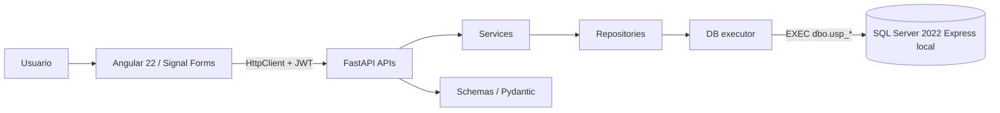

# TecnoStock S.A.C. — Sistema web de inventario

Aplicación web para administrar productos, categorías, entradas, salidas, existencias, stock bajo e historial de inventario. El frontend Angular consume una API FastAPI que persiste la información en SQL Server 2022 Express instalado localmente en Windows.

> **Repositorio:** [JBranez/TecnoStock-Entrega](https://github.com/JBranez/TecnoStock-Entrega)  
> **Instalación detallada:** [`docs/INSTALACION_EN_OTRA_PC.md`](docs/INSTALACION_EN_OTRA_PC.md)  
> **Configuración detallada del motor SQL Server y SSMS:** [`docs/INSTALACION_SQL_SERVER_LOCAL.md`](docs/INSTALACION_SQL_SERVER_LOCAL.md)

## Stack tecnológico

- **Frontend:** Angular 22.2.4, standalone components, Signals y Signal Forms; Bootstrap 5.3.8 (CSS solamente), Bootstrap Icons 1.13.2 y estilos propios responsive.
- **Backend:** Python 3.12, FastAPI, Uvicorn, Pydantic v2, pydantic-settings, pyodbc, PyJWT y Argon2 mediante pwdlib.
- **Base de datos:** SQL Server 2022 Express local en Windows, instancia `SQLEXPRESS`.
- **Conectividad:** Microsoft ODBC Driver 18 for SQL Server (x64), TCP/IP local.
- **Persistencia:** procedimientos almacenados `dbo.usp_*`; no se escribe SQL de negocio en Python.
- **Pruebas:** pytest, httpx, TestClient y pruebas del frontend Angular.

## Instalación rápida desde GitHub (Windows / PowerShell)

Esta sección está visible debajo de los archivos del repositorio. Para clonar sin iniciar sesión, el propietario debe cambiar previamente el repositorio a **Public**. Git permite clonar por HTTPS un repositorio público sin `gh auth login` ni token.

### 1. Instalar las herramientas que `run.ps1` no instala

Abre **PowerShell como administrador**. Necesitas WinGet (Windows Package Manager). Si `winget --version` falla, instala **App Installer** desde Microsoft Store y vuelve a abrir PowerShell.

El siguiente bloque instala Git, Python 3.12, Node.js LTS, SSMS 22 y ODBC Driver 18 x64 **solo cuando detecta que falta el componente**. No instala el motor SQL Server; ese paso requiere el asistente de SQL Server 2022 que se explica a continuación.

```powershell
$ErrorActionPreference = 'Stop'

if (-not (Get-Command winget -ErrorAction SilentlyContinue)) {
    throw 'WinGet no está disponible. Instala App Installer desde Microsoft Store y vuelve a abrir PowerShell.'
}

# Git: solo se instala si el comando git no existe.
if (-not (Get-Command git -ErrorAction SilentlyContinue)) {
    winget install --id Git.Git --exact --source winget --accept-source-agreements --accept-package-agreements
    if ($LASTEXITCODE -ne 0) { throw 'No se pudo instalar Git.' }
} else {
    Write-Host 'Git ya está instalado.' -ForegroundColor Green
}

# Python: exige el launcher py con la versión 3.12.
$python312Ok = $false
if (Get-Command py -ErrorAction SilentlyContinue) {
    py -3.12 --version *> $null
    $python312Ok = ($LASTEXITCODE -eq 0)
}
if (-not $python312Ok) {
    winget install --id Python.Python.3.12 --exact --source winget --accept-source-agreements --accept-package-agreements
    if ($LASTEXITCODE -ne 0) { throw 'No se pudo instalar Python 3.12.' }
} else {
    Write-Host 'Python 3.12 ya está instalado.' -ForegroundColor Green
}

# Node: instala la distribución LTS de WinGet si no existe.
if (-not (Get-Command node -ErrorAction SilentlyContinue)) {
    winget install --id OpenJS.NodeJS --exact --source winget --accept-source-agreements --accept-package-agreements
    if ($LASTEXITCODE -ne 0) { throw 'No se pudo instalar Node.js LTS.' }
} else {
    Write-Host ('Node.js detectado: ' + (node --version)) -ForegroundColor Green
}

# SSMS 22: detectar las rutas estándar antes de instalarlo.
$ssmsPaths = @(
    "${env:ProgramFiles(x86)}\Microsoft SQL Server Management Studio 22\Common7\IDE\Ssms.exe",
    "$env:ProgramFiles\Microsoft SQL Server Management Studio 22\Common7\IDE\Ssms.exe"
)
$ssmsInstalled = $false
foreach ($ssmsPath in $ssmsPaths) {
    if (Test-Path $ssmsPath) { $ssmsInstalled = $true; break }
}
if (-not $ssmsInstalled) {
    winget install --id Microsoft.SQLServerManagementStudio.22 --exact --source winget --accept-source-agreements --accept-package-agreements
    if ($LASTEXITCODE -ne 0) { throw 'No se pudo instalar SSMS 22.' }
} else {
    Write-Host 'SSMS 22 ya está instalado.' -ForegroundColor Green
}

# ODBC Driver 18 x64: descargar e instalar solo si no existe la versión x64.
$odbc64 = @()
if (Get-Command Get-OdbcDriver -ErrorAction SilentlyContinue) {
    $odbc64 = @(Get-OdbcDriver -Name 'ODBC Driver 18 for SQL Server' -ErrorAction SilentlyContinue |
        Where-Object { $_.Platform -match '64' })
}
if ($odbc64.Count -eq 0) {
    $odbcMsi = Join-Path $env:TEMP 'msodbcsql18-x64.msi'
    Invoke-WebRequest -Uri 'https://go.microsoft.com/fwlink/?linkid=2378279' -OutFile $odbcMsi
    $odbcInstall = Start-Process -FilePath 'msiexec.exe' `
        -ArgumentList "/i `"$odbcMsi`" /qn IACCEPTMSODBCSQLLICENSETERMS=YES" `
        -Wait -PassThru
    if ($odbcInstall.ExitCode -notin @(0, 3010)) {
        throw "Falló la instalación de ODBC Driver 18. Código: $($odbcInstall.ExitCode)"
    }
    if ($odbcInstall.ExitCode -eq 3010) {
        Write-Host 'ODBC se instaló; Windows solicita reiniciar el equipo.' -ForegroundColor Yellow
    }
    Remove-Item $odbcMsi -Force -ErrorAction SilentlyContinue
} else {
    Write-Host 'ODBC Driver 18 x64 ya está instalado.' -ForegroundColor Green
}

Write-Host 'Requisitos comprobados. Cierra y vuelve a abrir PowerShell antes de verificar PATH.' -ForegroundColor Green
```


Después de la instalación, cierra y vuelve a abrir PowerShell y verifica:

```powershell
git --version
py -3.12 --version
node --version
npm --version
Get-OdbcDriver -Name 'ODBC Driver 18 for SQL Server' | Format-Table Name, Platform, Attribute

$nodeVersion = [version]((node --version).TrimStart('v'))
$nodeSupported = (
    ($nodeVersion.Major -eq 22 -and $nodeVersion -ge [version]'22.22.3') -or
    ($nodeVersion.Major -eq 24 -and $nodeVersion -ge [version]'24.15.0') -or
    ($nodeVersion.Major -eq 26 -and $nodeVersion -ge [version]'26.0.0')
)
if (-not $nodeSupported) {
    throw "Node.js $nodeVersion no es compatible con Angular 22. Actualiza Node.js LTS."
}
Write-Host "Node.js $nodeVersion es compatible con Angular 22." -ForegroundColor Green
```

**Node.js para Angular 22.2.4:** utiliza una versión compatible: `22.22.3+` en la línea 22.x, `24.15.0+` en la línea 24.x o 26.x. `OpenJS.NodeJS` instala la distribución LTS disponible en WinGet. Si ya tienes Node pero su versión no cumple, actualízalo desde [Node.js](https://nodejs.org/en/download) o con `winget upgrade --id OpenJS.NodeJS --exact`. Angular publica la tabla de compatibilidad en [angular.dev/reference/versions](https://angular.dev/reference/versions).

ODBC Driver 18.7.1.1 x64 es la versión GA vigente al preparar esta guía (2 de noviembre de 2026); el enlace oficial puede entregar una versión posterior. Microsoft indica que desde 18.7 no hace falta preinstalar Visual C++ Redistributable. Consulta [descargas de ODBC Driver](https://learn.microsoft.com/sql/connect/odbc/download-odbc-driver-for-sql-server).

### 2. Instalar el motor SQL Server 2022 Express

**SQL Server Database Engine y SSMS son productos separados.** El comando de SSMS instala la herramienta de administración, no el motor de base de datos.

Descarga el instalador oficial de [SQL Server 2022 Express](https://www.microsoft.com/es-es/download/details.aspx?id=104781). Selecciona la instalación personalizada para configurar el nombre de instancia `SQLEXPRESS`, la autenticación mixta y el administrador de Windows. Después habilita TCP/IP y configura el puerto fijo `1433`.

Sigue todos los pasos de [`docs/INSTALACION_SQL_SERVER_LOCAL.md`](docs/INSTALACION_SQL_SERVER_LOCAL.md). No ejecutes `run.ps1` antes de que el servicio SQL Server esté instalado, iniciado y escuchando en el puerto configurado.

### 3. Clonar el repositorio público sin iniciar sesión

Una vez que el repositorio sea público, no necesitas GitHub CLI, token ni `gh auth login` para descargarlo:

```powershell
New-Item -ItemType Directory -Path 'C:\Dev' -Force | Out-Null
git clone https://github.com/JBranez/TecnoStock-Entrega.git C:\Dev\TecnoStock
Set-Location C:\Dev\TecnoStock
```

Para hacer público el repositorio, el propietario debe ir a **GitHub → TecnoStock-Entrega → Settings → General → Danger Zone → Change repository visibility → Public** y confirmar el cambio. GitHub explica el procedimiento y sus consecuencias en [su documentación oficial](https://docs.github.com/es/repositories/managing-your-repositorys-settings-and-features/managing-repository-settings/setting-repository-visibility).

**Antes de hacerlo público**, revisa el historial completo y confirma que nunca se hayan versionado `.env`, `backend/.env`, contraseñas, tokens, claves JWT o backups. El repositorio público expone el código y el historial de commits a cualquier visitante. Los archivos `.env` deben permanecer ignorados por Git; solo se publican `.env.example` con valores de ejemplo.

Puedes comprobar si los archivos `.env` están versionados:

```powershell
git ls-files .env backend/.env
git log --all --full-history --oneline -- .env backend/.env
git check-ignore -v .env backend/.env
```

Los dos primeros comandos no deben mostrar archivos ni commits. El tercero debe confirmar que ambos `.env` están ignorados. También revisa manualmente que no haya secretos escritos en otros archivos o commits.

> La clonación y la descarga (`git clone`, `git pull`) de un repositorio público no requieren iniciar sesión. Para subir cambios (`git push`), crear PR o administrar el repositorio sí necesitas autenticarte y tener permisos.

### 4. Configurar las credenciales locales

Desde la raíz del proyecto:

```powershell
Set-ExecutionPolicy -Scope Process -ExecutionPolicy Bypass
.\setup.ps1
```

`setup.ps1` solicita la contraseña que configuraste para el login `sa` de **esa instalación local de SQL Server**. Luego crea `.env` y `backend/.env`, genera la contraseña de `tecnostock_app`, el secreto JWT y la contraseña del administrador de demostración. Guarda la contraseña de `admin` que imprime el asistente. No publiques los archivos `.env`.

Si `setup.ps1` indica que los archivos `.env` ya existen, no sobrescribe sus credenciales. Comprueba que `MSSQL_SA_PASSWORD` sea la contraseña real de `sa` y que las variables de ambos archivos coincidan.

### 5. Ejecutar TecnoStock

Con SQL Server iniciado, ejecuta:

```powershell
.\run.ps1
```

`run.ps1` **no instala** Git, Python, Node.js, ODBC ni SQL Server. Esos son requisitos previos. Una vez instalados, `run.ps1` prepara el entorno virtual Python, instala los paquetes de `requirements-dev.txt`, instala las dependencias Angular con `npm ci` cuando hace falta, compila Angular, ejecuta las pruebas, inicializa SQL Server, carga datos de demostración y abre FastAPI y Angular en ventanas separadas.

Direcciones locales:

- Frontend: <http://localhost:4200>
- API: <http://localhost:8000/api/v1>
- Swagger: <http://localhost:8000/docs>
- Salud: <http://localhost:8000/health>

Para cerrar la aplicación, cierra las ventanas de PowerShell de FastAPI y Angular. SQL Server permanece como servicio de Windows.

## Funcionalidades

- **Login:** `POST /auth/login`, `GET /auth/me`, JWT Bearer en `sessionStorage`.
- **Dashboard:** productos activos, stock bajo, valor referencial, entradas y salidas del rango, últimos movimientos y productos críticos.
- **Categorías:** listar, crear, editar y eliminar con validación de relaciones.
- **Productos:** búsqueda, filtros, paginación, alta, edición, activación/desactivación y eliminación condicionada.
- **Movimientos:** registro de entradas y salidas, validación de stock y actualización transaccional.
- **Historial:** filtros por producto, fechas y tipo, paginación y usuario.
- **Stock bajo:** listado de productos con stock igual o inferior al mínimo.
- **Recuperación administrativa:** script local `backend/scripts/reset_admin_password.py`; genera Argon2id en Python y actualiza la cuenta mediante un procedimiento almacenado. Consulta [`docs/RECUPERAR_ADMIN.md`](docs/RECUPERAR_ADMIN.md).

## Arquitectura



Responsabilidades: APIs gestiona HTTP y dependencias; Schemas define contratos y valida datos; Services aplica reglas de negocio y orquesta; Repositories llama a procedimientos almacenados; `db/executor.py` es el único ejecutor de SP. Los routers son funciones síncronas porque `pyodbc` es síncrono.

## Pruebas manuales

`run.ps1` ejecuta las pruebas frontend y backend antes de iniciar los servicios. Para ejecutarlas por separado:

```powershell
.\backend\.venv\Scripts\python.exe -m pytest backend/tests -q
Set-Location frontend
npm test -- --watch=false
```

Para probar la integración contra el motor real, revisa [`database/PRUEBAS_MANUALES.md`](database/PRUEBAS_MANUALES.md).

## Seguridad y datos

- `.env` y `backend/.env` son secretos locales ignorados por Git. Solo se versionan `.env.example`.
- `MSSQL_SA_PASSWORD` se usa durante la inicialización; FastAPI se conecta como `tecnostock_app`, nunca como `sa`.
- Las contraseñas de usuarios se almacenan con Argon2id.
- No hay secretos de base de datos ni JWT en Angular.
- Los procedimientos almacenados realizan las operaciones de persistencia; las entradas y salidas mantienen stock e historial en una misma transacción.

## Datos de demostración frente a datos reales

Una instalación limpia carga categorías, productos y movimientos de demostración. Clonar el repositorio no transfiere los datos que estén en otra base de datos. Para conservar inventario, usuarios y movimientos existentes, realiza un backup `.bak` de SQL Server y restáuralo en el equipo destino siguiendo [`docs/INSTALACION_EN_OTRA_PC.md`](docs/INSTALACION_EN_OTRA_PC.md).

## Documentación

- [Instalación desde GitHub en otra PC](docs/INSTALACION_EN_OTRA_PC.md)
- [Instalación detallada de SQL Server 2022 Express y SSMS](docs/INSTALACION_SQL_SERVER_LOCAL.md)
- [Arquitectura](docs/ARQUITECTURA.md)
- [Modelo de datos](docs/MODELO_DATOS.md)
- [API](docs/API.md)
- [Guía de sustentación](docs/SUSTENTACION.md)
- [Errores frecuentes de Windows](docs/ERRORES_WINDOWS.md)
- [Git y GitHub](docs/GIT_Y_GITHUB.md)
