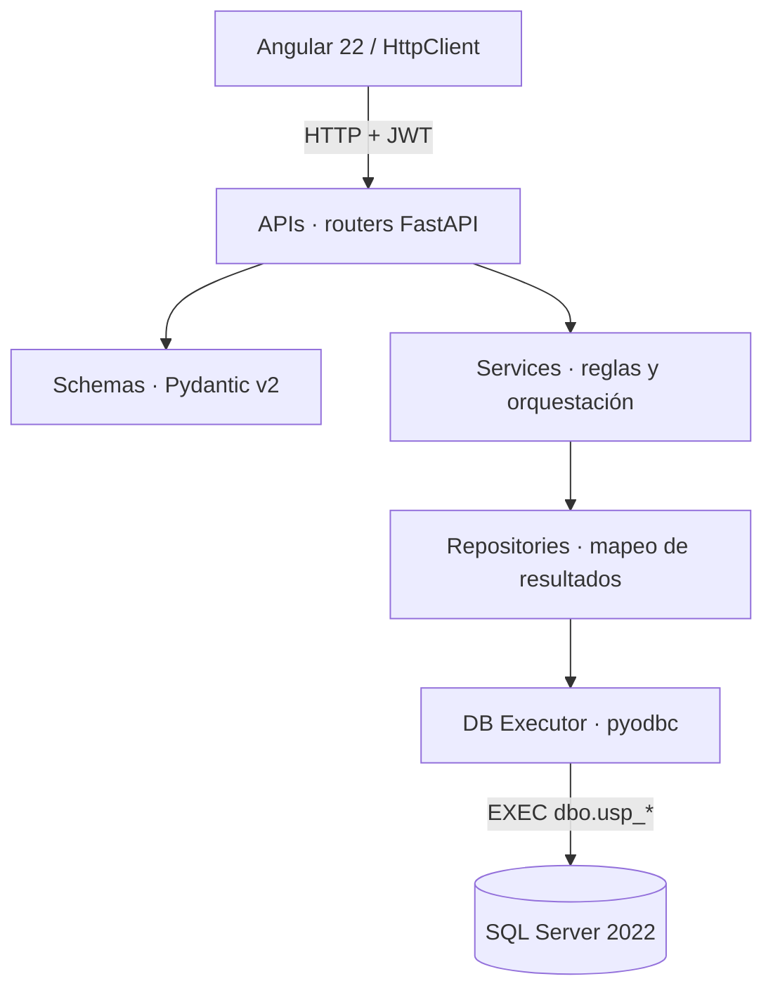
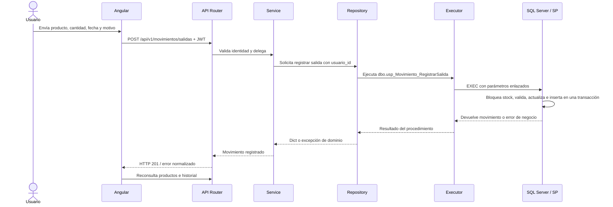
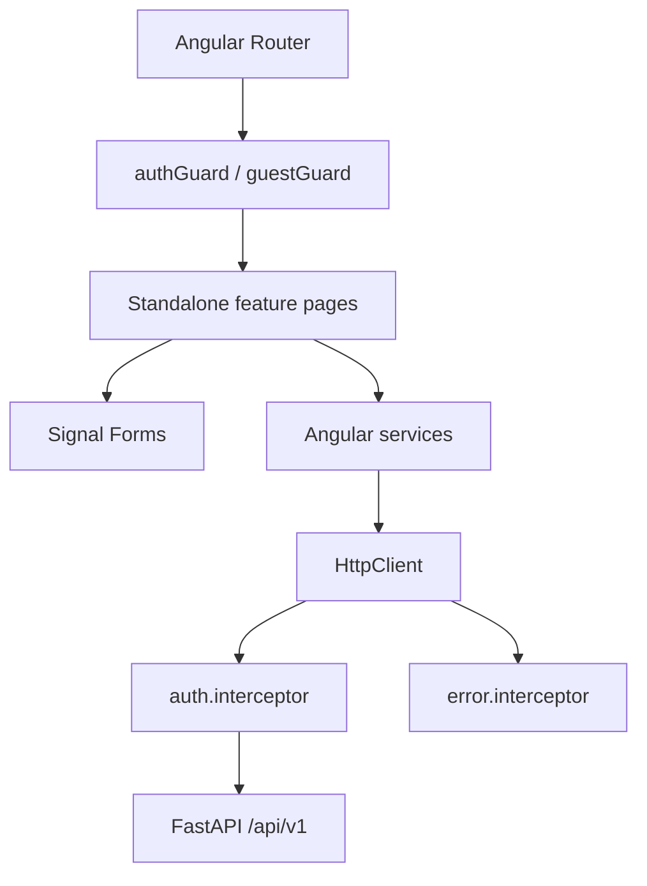

# Arquitectura de TecnoStock

## Capas del backend

- **APIs:** rutas, dependencias, autorización y códigos HTTP. No conoce SQL ni reglas del inventario.
- **Schemas:** contratos de entrada/salida y validación estructural.
- **Services:** reglas de negocio y coordinación de operaciones.
- **Repositories:** invoca SP mediante el executor y convierte resultados/errores de BD en datos o excepciones de dominio.
- **DB Executor:** único punto Python que ejecuta procedimientos almacenados.

## Secuencia implementada: registrar una salida

La transacción, `UPDLOCK`, `XACT_ABORT` y las restricciones de la BD protegen la consistencia entre stock e historial ante operaciones concurrentes o fallidas. La pantalla de Movimientos ya utiliza esta secuencia mediante `MovimientoService`.

## Implementación actual

- `GET /health` prueba disponibilidad de SQL Server a través de `dbo.usp_Dashboard_ObtenerIndicadores`; no ejecuta una consulta SQL directa desde el router.
- `POST /api/v1/auth/login` es la única ruta de la API versionada sin JWT. Las demás rutas validan el token y consultan que el usuario siga activo.
- Cada request autenticado comparte una conexión síncrona `pyodbc` a través de dependencias FastAPI. Se cierra al terminar el request. El cursor se cierra dentro del executor.
- La conexión usa `autocommit=True`; los procedimientos de movimientos son responsables de abrir, confirmar y revertir sus transacciones.
- Los result sets de paginación son leídos en orden: total filtrado y después filas de la página. El executor no conoce las entidades; solo traduce columnas a diccionarios.

## Cliente Angular conectado

Cada feature page usa modelos de `core/models` y servicios tipados de `core/services`. Después de las operaciones de escritura vuelve a consultar su endpoint de listado; el frontend no conserva un catálogo local de productos o categorías. La búsqueda por código/nombre y el typeahead de movimientos aplican debounce de 300 ms; los avisos se centralizan en `ToastService`.
