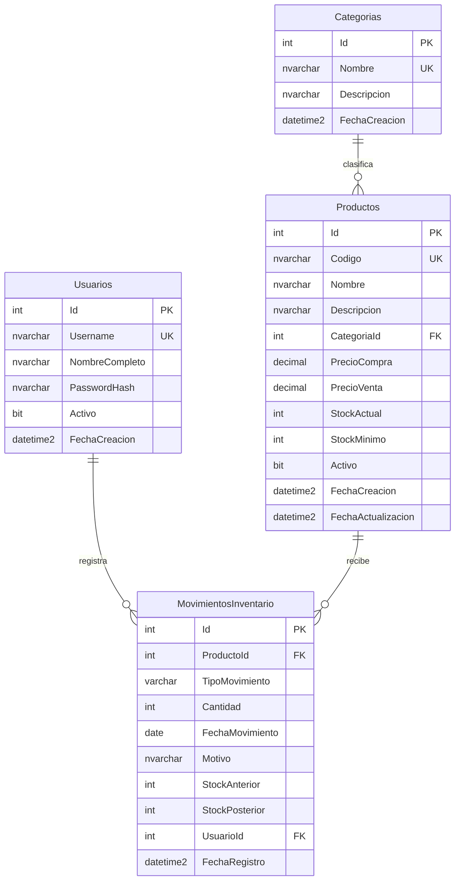

# Modelo de datos de TecnoStock

## Diagrama entidad-relación

## Diccionario de datos

| Tabla | Columna | Tipo | Regla |
|---|---|---|---|
| Usuarios | Id | INT IDENTITY | PK |
| Usuarios | Username | NVARCHAR(50) | Único, obligatorio |
| Usuarios | NombreCompleto | NVARCHAR(100) | Obligatorio |
| Usuarios | PasswordHash | NVARCHAR(255) | Hash Argon2; nunca contraseña en texto plano |
| Usuarios | Activo | BIT | DEFAULT 1 |
| Usuarios | FechaCreacion | DATETIME2(0) | DEFAULT SYSDATETIME() |
| Categorias | Id | INT IDENTITY | PK |
| Categorias | Nombre | NVARCHAR(80) | Único, obligatorio |
| Categorias | Descripcion | NVARCHAR(250) | Opcional |
| Categorias | FechaCreacion | DATETIME2(0) | DEFAULT SYSDATETIME() |
| Productos | Id | INT IDENTITY | PK |
| Productos | Codigo | NVARCHAR(30) | Único; normalizado a mayúsculas por schema y SP |
| Productos | Nombre | NVARCHAR(120) | Obligatorio |
| Productos | Descripcion | NVARCHAR(500) | Opcional |
| Productos | CategoriaId | INT | FK a Categorias.Id, sin cascada |
| Productos | PrecioCompra / PrecioVenta | DECIMAL(12,2) | Ambos mayores que cero |
| Productos | StockActual | INT | DEFAULT 0, CHECK >= 0 |
| Productos | StockMinimo | INT | DEFAULT 0, CHECK >= 0 |
| Productos | Activo | BIT | DEFAULT 1 |
| Productos | FechaCreacion / FechaActualizacion | DATETIME2(0) | Creación automática y actualización por SP |
| MovimientosInventario | Id | INT IDENTITY | PK |
| MovimientosInventario | ProductoId | INT | FK a Productos.Id, sin cascada |
| MovimientosInventario | TipoMovimiento | VARCHAR(10) | ENTRADA o SALIDA |
| MovimientosInventario | Cantidad | INT | CHECK > 0 |
| MovimientosInventario | FechaMovimiento | DATE | Fecha operativa; los SP rechazan fechas futuras |
| MovimientosInventario | Motivo | NVARCHAR(200) | Obligatorio |
| MovimientosInventario | StockAnterior / StockPosterior | INT | No negativos y coherentes con tipo y cantidad |
| MovimientosInventario | UsuarioId | INT | FK a Usuarios.Id, sin cascada |
| MovimientosInventario | FechaRegistro | DATETIME2(0) | DEFAULT SYSDATETIME() |

## Índices

- `IX_Productos_Nombre`: apoya la búsqueda de productos por nombre.
- `IX_Productos_CategoriaId`: apoya el filtro de categoría.
- `IX_Movimientos_Producto_Fecha`: historial por producto y fecha.
- `IX_Movimientos_Fecha`: listados globales por rango temporal.

No se utiliza `ON DELETE CASCADE`. El motor impide eliminar una categoría con productos y un producto con movimientos. La eliminación física de productos solo se admite cuando no tienen historial; para productos usados se conserva la fila y se cambia `Activo`.

Los movimientos son append-only. El stock anterior y posterior siguen el orden de registro (Id), aunque la fecha operativa corresponda a un día pasado. La fecha operativa no puede ser futura; esta regla se aplica en los procedimientos porque una restricción CHECK no es apropiada para depender de la fecha del servidor.
